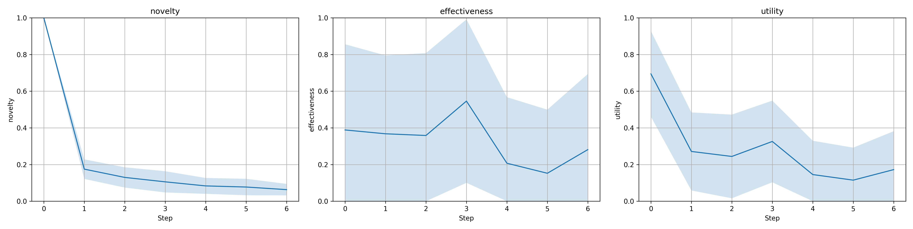
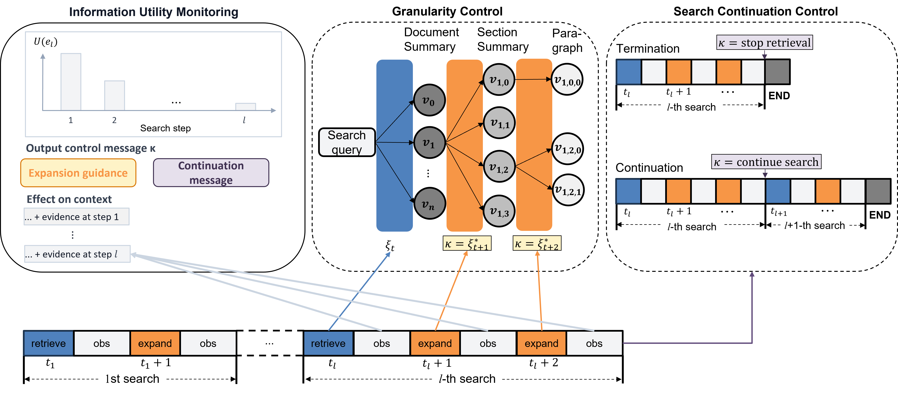
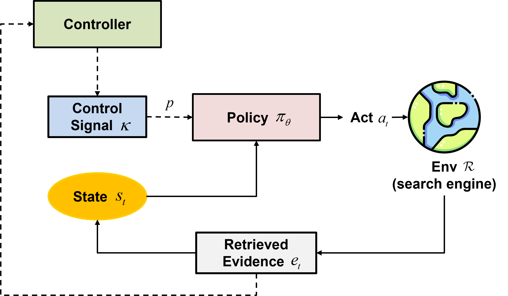

# DeepControl: Adaptive Information Control for Search-Augmented LLM Reasoning

This repository contains the official implementation of the **[EMNLP 26, ICLR 26 Scaling Post-training for LLMs Workshop]** paper: [Adaptive Information Control for Search-Augmented LLM Reasoning](https://arxiv.org/pdf/2602.01672).

Search-augmented LLM agents have become a powerful paradigm for solving knowledge-intensive tasks.
However, naive retrieval often introduces redundant evidence, long contexts, and unstable reasoning behaviors.

DeepControl introduces a principled framework that enables LLM agents to actively regulate information acquisition during reasoning.

## Overview

DeepControl is built upon a formal notion of information utility, which measures the marginal value of retrieved evidence under the current reasoning state.

<p align="center">
  
</p>

Based on this formulation, the framework introduces three key mechanisms:

* **Retrieval continuation control**
  → Decide *when to continue or stop retrieving*

* **Granularity control**
  → Decide *how much information to expand*

<p align="center">
  
</p>

* **Annealed control training**
  → Enables the agent to internalize efficient information acquisition behavior

<p align="center">
  
</p>

Together, these mechanisms transform retrieval from a passive tool into an actively regulated decision process.

| Model      | Search-R1 | Ours      | Improvement |
| ---------- | --------- | --------- | ----------- |
| Qwen2.5-7B | 0.385     | **0.479** | +9.4%       |
| Qwen2.5-3B | 0.325     | **0.411** | +8.6%       |


## Directory Structure

```text
DeepControl/
+-- data/
+-- deepcontrol/
+-- logs/
+-- outputs/
+-- scripts/
+-- verl/
+-- wandb/
```

## Installation

### DeepControl environment

```bash
conda create -n deepcontrol python=3.9
conda activate deepcontrol
pip install torch==2.4.0 --index-url https://download.pytorch.org/whl/cu121
pip install vllm==0.6.3

# verl
pip install -e .

# flash attention 2
pip install flash-attn --no-build-isolation
pip install wandb
```

### Inference environment

Serving the released checkpoints and running `infer_fast.py` uses a separate environment.

```bash
conda create -n deepcontrol-infer python=3.11
conda activate deepcontrol-infer
pip install -r requirements-infer.txt
pip install datasets
```

### Retriever environment (Optional)

If you want to run a local retriever server, we recommend a separate environment.

```bash
conda create -n retriever python=3.10
conda activate retriever

# torch for faiss-gpu
conda install pytorch==2.4.0 pytorch-cuda=12.1 -c pytorch -c nvidia
pip install transformers datasets pyserini

# FAISS GPU
conda install -c pytorch -c nvidia faiss-gpu=1.8.0

# API server
pip install uvicorn fastapi
```

## Quick Start

### Training
Train a search-augmented reasoning agent with e5 as the retriever and Wikipedia as corpus.

1. Download the index and corpus.

```bash
save_path=/the/path/to/save
python scripts/download.py --save_path $save_path
cat $save_path/part_* > $save_path/e5_Flat.index
gzip -d $save_path/wiki-18.jsonl.gz
```

2. Process datasets.

```bash
python scripts/data_process/nq_search.py
python scripts/data_process/hotpotqa_search.py
python scripts/data_process/nq_hotpotqa_search.py
```

3. Launch local retrieval server.

```bash
conda activate retriever
# Recommended: CPU-based retriever for RL training
bash scripts/entryretrieval_launch_CPU.sh
```

4. Run RL training.

```bash
conda activate deepcontrol
bash scripts/train_ppo.sh
bash scripts/train_grpo.sh
```

### Inference
DeepControl supports two inference modes.

#### Baseline
1. Launch local retrieval server:
The retriever returns raw passages and supports a single action, i.e., retrieve.
```bash
conda activate retriever
bash scripts/retrieval_launch_CPU.sh

# Optional: GPU-based retriever
# bash scripts/retrieval_launch.sh
```

2. Run agentic inference:
Requires APIs that support single-turn prefill (e.g. vLLM).
```bash
conda activate deepcontrol
bash scripts/run_local_vllm_service_baseline.sh
bash scripts/infer_vanilla_fast.sh
```


#### DeepControl (Hierarchical Retrieval)
1. Launch local retrieval server:
The retriever returns hierarchical retrieval results and supports two actions, i.e., retrieve and expand.
```bash
conda activate retriever
bash scripts/entryretrieval_launch_CPU.sh

# Optional: GPU-based retriever
# bash scripts/entryretrieval_launch.sh
```

2. Run agentic inference:
Retrieved information will be added as user messages, which allows compatibility with most APIs, including proprietary models.
```bash
conda activate deepcontrol-infer

# Optional: local inference on one GPU
bash scripts/run_local_vllm_service.sh

bash scripts/infer_fast.sh
```

On a multi-GPU machine, serve one vLLM instance per GPU behind a least-busy proxy and split a
dataset across several concurrent client processes:

```bash
conda activate deepcontrol-infer
MODEL=sxiong/DeepControl-Qwen2.5-3B SERVED_NAME=deepcontrol-qwen25-3b NUM_GPUS=8 \
  bash scripts/run_local_vllm_pool.sh          # proxy at http://127.0.0.1:8001/v1

CONFIG=hotpotqa SPLIT=dev MODEL=deepcontrol-qwen25-3b NUM_PROCS=8 NUM_WORKERS=16 \
  bash scripts/infer_fast_parallel.sh
```

## Datasets

All the datasets can be found at [here](https://huggingface.co/datasets/RUC-NLPIR/FlashRAG_datasets).

## Checkpoints

We release the following DeepControl checkpoints on Hugging Face:

| Checkpoint | Base model |
| ---------- | ---------- |
| [DeepControl-Qwen2.5-3B](https://huggingface.co/sxiong/DeepControl-Qwen2.5-3B) | Qwen2.5-3B-Instruct |
| [DeepControl-Qwen2.5-7B](https://huggingface.co/sxiong/DeepControl-Qwen2.5-7B) | Qwen2.5-7B-Instruct |

The checkpoints use the standard Hugging Face format and can be loaded directly with Transformers or served with vLLM. For example:

```bash
vllm serve sxiong/DeepControl-Qwen2.5-3B \
  --served-model-name deepcontrol-qwen25-3b \
  --dtype bfloat16 \
  --max-model-len 8192 \
  --host 127.0.0.1 \
  --port 8001
```

#### API Keys

If you want to run the system with external inference APIs (e.g., OpenAI, DeepSeek, Aliyun), you need to configure the corresponding API keys.
```bash
cp env.sample .env
```
Edit .env with your API keys
```bash
# LLM keys
OPENAI_API_KEY=
DEEPSEEK_API_KEY=
ALIYUN_API_KEY=
```

## Outputs

We release the evaluation trajectories at [sxiong/deepcontrol_output](https://huggingface.co/datasets/sxiong/deepcontrol_output). Each benchmark contains outputs from DeepControl-Qwen2.5-3B, DeepControl-Qwen2.5-7B, DeepSeek-V4-Flash, and GPT-5.6-Luna.

Load a subset with the Hugging Face `datasets` library:

```python
from datasets import load_dataset

outputs = load_dataset(
    "sxiong/deepcontrol_output",
    "hotpotqa_dev_DeepControl-Qwen2.5-7B",
    split="train",
)

example = outputs[0]
print(example["question"])
print(example["pred_answer"], example["final_correct"])
print(example["actions"])
```

## Acknowledge

The implementation is built upon [veRL](https://github.com/volcengine/verl) and [Search-R1](https://github.com/PeterGriffinJin/Search-R1).
We sincerely appreciate these teams for their open-source contributions.


## Citation

```bibtex
@article{xiong2026adaptive,
  title={Adaptive Information Control for Search-Augmented LLM Reasoning},
  author={Xiong, Siheng and Gungordu, Oguzhan and Kerce, James C and Fekri, Faramarz},
  journal={arXiv preprint arXiv:2602.01672},
  year={2026}
}
```
